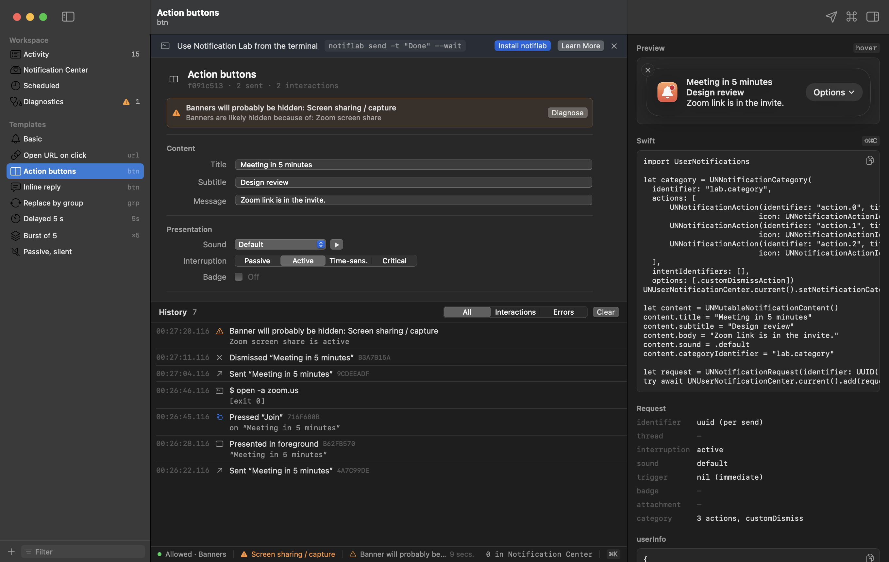
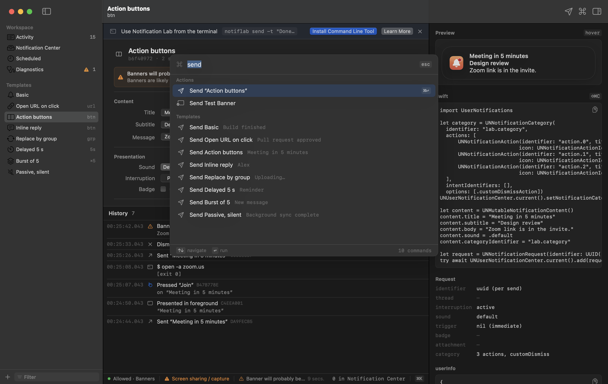
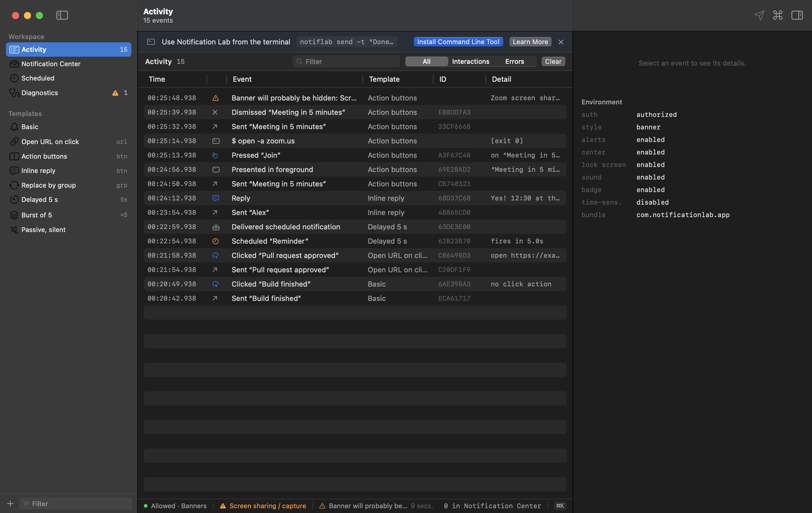
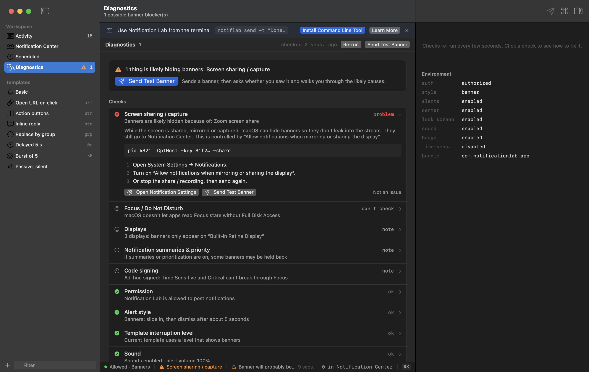
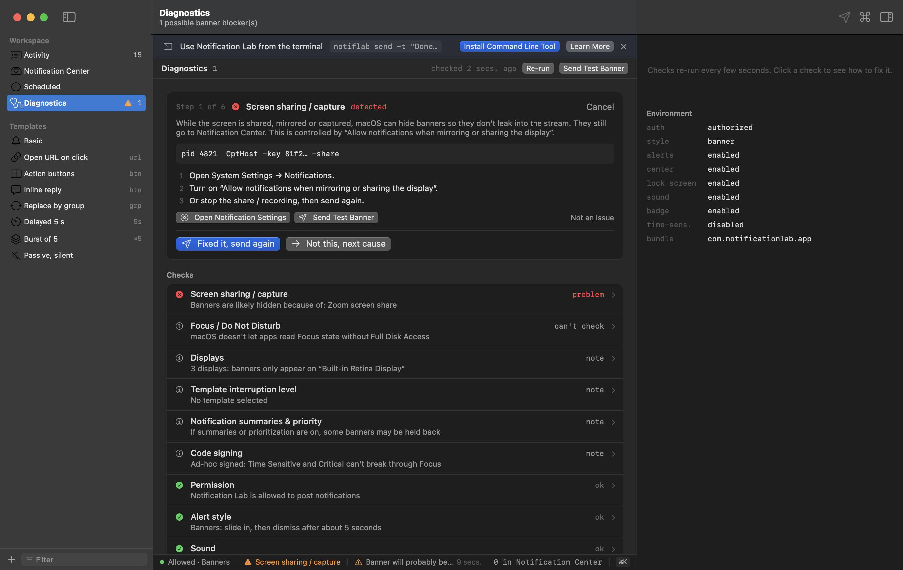
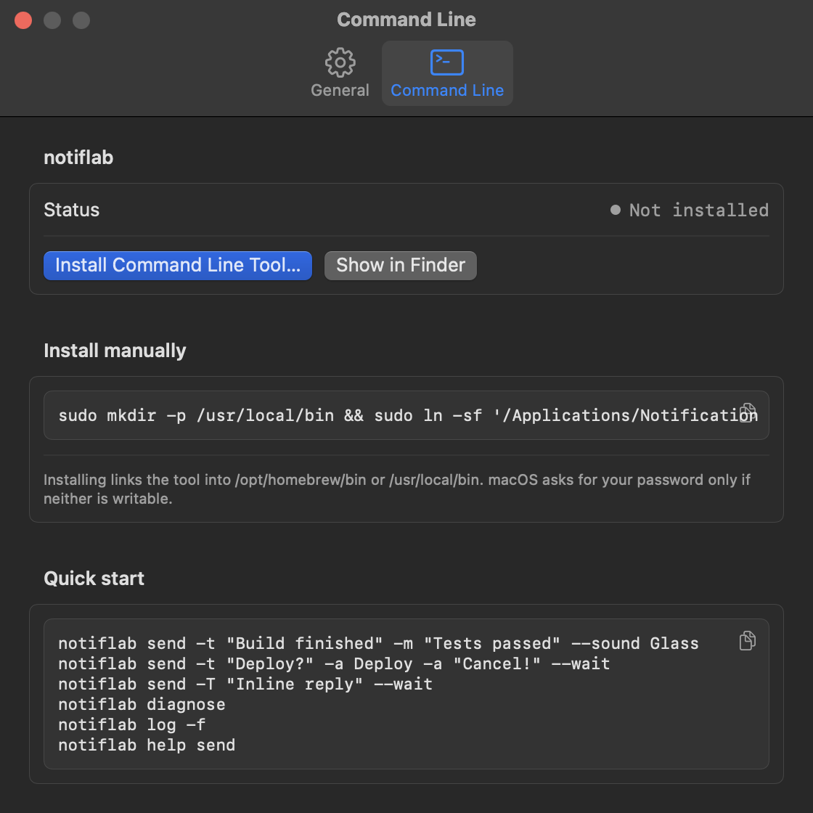
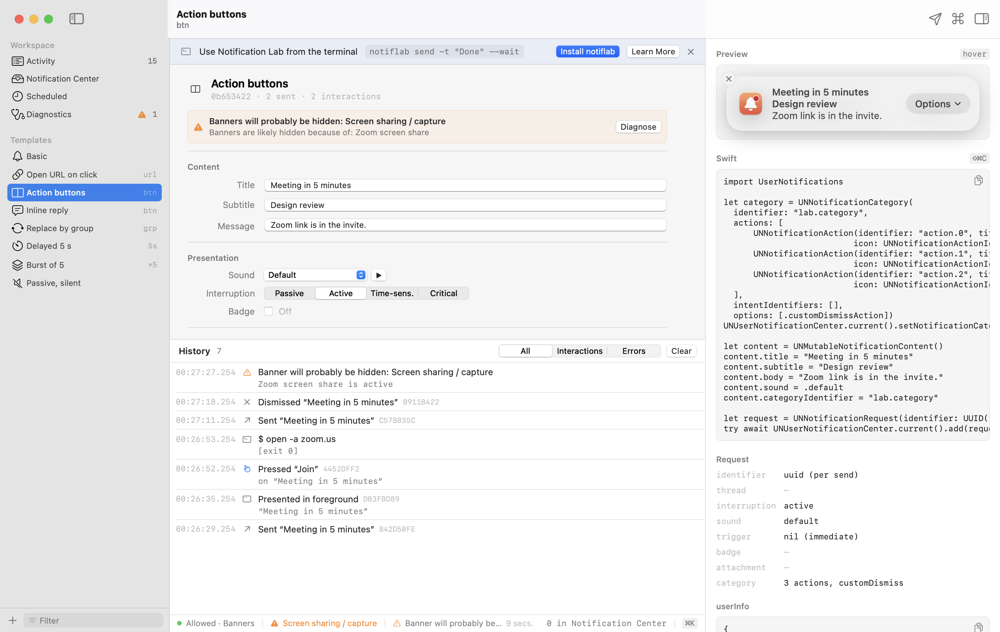

# Notification Lab

A native macOS workbench for designing, sending and debugging local notifications.

Build a notification, see an accurate preview, send it with ⌘↩, and watch everything that happens to it: delivery, clicks, button presses, replies, dismissals. When a banner doesn't show up, the built-in diagnostics tell you why and how to fix it. The bundled **`notiflab`** command-line tool brings all of it to your terminal and scripts.



## Features

- **Templates**: a sidebar library of reusable notifications, saved to disk. Reorder by dragging, filter, rename inline, duplicate, and change icons from the context menu.
- **Everything the API offers**: title, subtitle, body, system sounds (with preview), interruption level, Dock badge, thread grouping, replace-by-identifier, delay, bursts, image attachments, up to four action buttons with SF Symbol icons, an inline text reply, and dismissal reporting.
- **Click actions**: open a URL, activate an app by bundle ID, or run a shell command. Command output streams live into the history.
- **Accurate preview**: matches the current macOS banner. Hover it to see the Clear button and the **Options** menu, which holds your actions.
- **History and Activity**: a per-template history plus a global, filterable activity table, with monospaced timestamps and notification IDs.
- **Notification Center and Scheduled views**: see what's delivered, remove items, and watch scheduled notifications count down.
- **Inspector**: shows the exact `UserNotifications` Swift code for the current template, plus request details, `userInfo` JSON and the app's live notification settings.
- **Diagnostics**: detects the usual and less obvious reasons banners don't appear, and walks you through fixing each one (see below).
- **Command-line tool**: `notiflab` sends, waits for a click, action or reply, lists, cancels, diagnoses and streams the log. See [Command-line tool](#command-line-tool).
- **Keyboard-first**: a ⌘K command palette and shortcuts for everything. Works in light and dark mode.

| Command palette | Activity |
|---|---|
|  |  |

## Diagnostics: "why isn't my banner showing?"

A notification can land in Notification Center without ever sliding in as a banner. Notification Lab checks for the reasons, explains each one, and links to the right System Settings pane.

| Check | What it catches |
|---|---|
| Permission | Not requested, denied, or provisional (quiet delivery only) |
| Alert style | Style set to **None**, or alerts disabled |
| Screen sharing / capture | Zoom screen share, incoming Screen Sharing, display mirroring, continuous screen recorders. Also flags OBS, Loom, Teams and others while they're running. macOS hides banners while sharing unless "Allow notifications when mirroring or sharing the display" is on. |
| Focus / Do Not Disturb | Names the active Focus when the app has Full Disk Access; otherwise explains how to check manually |
| Displays | With several displays, banners only appear on the one with the menu bar; also notes virtual displays |
| Interruption level | Passive notifications never show a banner, by design |
| Sound | App sound off, output muted, or **alert volume at 0** |
| App copies | Several builds registered under one bundle ID, so settings can apply to the wrong copy |
| Summaries, signing, foreground | Explains behavior that can't be detected or changed from inside the app |

**Send Test Banner** starts a guided flow: it posts a banner and asks whether you saw it. If you didn't, it walks through likely causes one at a time, detected problems first. The last step restarts the Notification Center process, which fixes the occasional stuck banner queue.

| Diagnostics | Guided fix |
|---|---|
|  |  |

## Command-line tool

`notiflab` ships inside the app. Install it from the banner in the main window or from **Settings → Command Line**. That links it into `/opt/homebrew/bin` or `/usr/local/bin`, asking for your password only if neither is writable. To install it by hand:

```sh
sudo mkdir -p /usr/local/bin
sudo ln -sf "/Applications/Notification Lab.app/Contents/Helpers/notiflab" /usr/local/bin/notiflab
```

macOS only lets app bundles post notifications, and it routes clicks back to the app. So `notiflab` is a thin client that talks to Notification Lab over local distributed notifications, starting it hidden in the background if it isn't running. Every send shows up in the app's Activity log too.

```sh
# Send
notiflab send -t "Build finished" -m "All 128 tests passed" --sound Glass
make test 2>&1 | tail -1 | notiflab send -t "make test" -m -     # body from stdin
notiflab send -t "Uploading" -m "45%" -g upload --silent          # same -g replaces in place
notiflab send -t "Standup" -d 10m                                 # schedule
notiflab send -T "Burst of 5" -t "Overridden title"               # start from a saved template

# Ask and wait: prints clicked | action:<title> | reply:<text> | dismissed
choice=$(notiflab send -t "Deploy to production?" -a Deploy@paperplane -a "Cancel@xmark!" --wait --timeout 2m)
[ "$choice" = "action:Deploy" ] && ./deploy.sh

notiflab send -t "Alex" -m "Lunch?" --reply "Type a reply…" --wait   # → reply:Sounds good

# Inspect and manage
notiflab templates              # saved templates (templates NAME prints one as JSON)
notiflab list                   # in Notification Center
notiflab pending                # scheduled, with countdowns
notiflab remove --all           # or IDs; `cancel` for scheduled ones
notiflab badge 3                # badge clear
notiflab log -f                 # stream activity live

# Debug
notiflab status                 # permission and settings
notiflab diagnose               # what's hiding banners (exit 3 if something is)
notiflab test                   # send a test banner, then walk through fixes interactively
notiflab snippet -t Hi -a OK    # print the UserNotifications Swift code
```

| Option | Meaning |
|---|---|
| `-t` `-s` `-m` | title, subtitle, message (`-m -` reads stdin; bare words also become the message) |
| `-T NAME` | start from a saved template, then apply the other options |
| `--sound NAME`, `--silent` | `default`, `none`, or a system sound such as `Glass` |
| `--level`, `--passive` | `passive`, `active`, `time-sensitive`, `critical` |
| `-g ID`, `--thread ID` | identifier (replaces a previous notification) and stack grouping |
| `-d 5s`, `-n 5`, `--badge 3` | delay, repeat count, Dock badge |
| `-o URL`, `--activate ID`, `-x CMD` | on click: open a URL, activate an app, run a shell command |
| `-a TITLE[@symbol][!]` | action button with optional SF Symbol; `!` makes it destructive (up to 4) |
| `-r [PLACEHOLDER]`, `--reply-button` | inline text reply |
| `-i PATH` | image attachment |
| `-w`, `--timeout 2m` | wait for the response and print it |
| `--json` | machine-readable output, for any command |

Data goes to stdout and progress goes to stderr. Exit codes: `0` ok · `1` error · `2` app unavailable · `3` banner blockers found · `4` timed out. Run `notiflab help send` for everything.



## Install

1. Download the zip from the [latest release](../../releases/latest) and unzip it.
2. Move **Notification Lab.app** to `/Applications`.
3. The app is ad-hoc signed, not notarized, so macOS blocks the first launch. Open it once, then go to **System Settings → Privacy & Security** and click **Open Anyway**. Or clear the quarantine flag from Terminal:
   ```sh
   xattr -dr com.apple.quarantine "/Applications/Notification Lab.app"
   ```
4. Click **Allow** when asked for notification permission.
5. Optional: click **Install notiflab** in the banner to get the command-line tool.

Requires macOS 14 Sonoma or later. Universal binary (Apple Silicon and Intel).

## Build from source

Requires Xcode 15 or later (Swift 5.9+).

```sh
git clone https://github.com/rdong25/notification-lab.git
cd notification-lab
./build.sh --open          # builds build/Notification Lab.app and launches it
./build.sh --universal     # Apple Silicon + Intel
scripts/package.sh         # universal build, zipped for release
```

This is a plain Swift package with no Xcode project and two executables: the app and `notiflab`. `build.sh` compiles both, wraps the app in an `.app` bundle with `Support/Info.plist` and a generated icon, embeds `notiflab` at `Contents/Helpers/`, and ad-hoc signs it all. To try the CLI without installing it, run `"build/Notification Lab.app/Contents/Helpers/notiflab" help`. macOS only grants notification permission to apps with a bundle identifier, which is why the app has to run from the bundle.

## Keyboard shortcuts

| Keys | Action |
|---|---|
| ⌘K | Command palette (↑ ↓ to move, ↩ to run, esc to close) |
| ⌘↩ | Send the current template |
| ⌘N / ⌘D | New / duplicate template |
| ⌘1 – ⌘4 | Activity · Notification Center · Scheduled · Diagnostics |
| ⌘R | Run diagnostics |
| ⌥⌘I | Show or hide the inspector |
| ⇧⌘Y | Show or hide the history pane |
| ⌃⌘S | Show or hide the sidebar |
| ⇧⌘C | Copy the Swift snippet |
| ⇧⌘⌫ | Remove all delivered notifications |
| ⌥⌘K | Clear the activity log |
| ⌘, | Settings (command-line tool, banner, diagnostics) |
| ⌫ | Delete the selected template, notification or scheduled item |

## How it works

- Notifications are posted directly with Apple's [`UserNotifications`](https://developer.apple.com/documentation/usernotifications) framework (`UNUserNotificationCenter`). There are no helper tools or private APIs.
- The app's notification delegate returns `.banner` in `willPresent`, so banners appear even while Notification Lab is the active app. By default macOS hides banners from the frontmost app.
- Action buttons and the reply field are registered as a `UNNotificationCategory` for each distinct configuration. Clicks, actions, replies and dismissals come back through `didReceive` and are logged.
- Attachments are copied before sending, because the system moves attachment files into its own store.
- Templates are stored as JSON in `~/Library/Application Support/NotificationLab/templates.json`.

## Limitations

- **Time Sensitive and Critical** levels need Apple-issued entitlements. macOS refuses to launch an ad-hoc-signed app that carries them, so this build delivers those levels as Active. Signing with a Developer ID and a provisioning profile enables Time Sensitive.
- **Focus detection** needs Full Disk Access, because apps have no public API for reading Focus state. Ad-hoc builds lose that grant whenever they're rebuilt.
- **Screen-capture detection** is a heuristic based on known process names. You can add your own: `defaults write com.notificationlab.app diag.captureProcesses -array "my-recorder"`. macOS doesn't expose whether "Allow notifications when sharing" is on, so a detected share might not actually be hiding banners. Mark it **Not an Issue** to dismiss it.

## Project layout

```
Sources/notiflab/
  main.swift                The command-line client
Sources/NotificationLab/
  App.swift                 App entry, menus and shortcuts, root split view
  AppState.swift            Template library, selection, command-palette commands
  NotificationService.swift UNUserNotificationCenter wrapper, event log, shell jobs
  Diagnostics.swift         Banner checks and fix guidance
  DiagnosticsView.swift     Diagnostics screen and guided test flow
  TemplateWorkspace.swift   Editor and per-template history
  ListViews.swift           Activity, Notification Center and Scheduled tables
  Chrome.swift              Inspector, status bar, command palette
  Components.swift          Shared views, including the banner preview
  Model.swift               Template model, Swift snippet generator, theme
  CLIServer.swift           Answers notiflab requests (distributed notifications)
  CLIInstaller.swift        Links notiflab onto the PATH
  SettingsView.swift        Settings window and the install banner
  ScreenshotMode.swift      Renders README screenshots with demo data
Support/Info.plist
scripts/make_icon.swift     Generates the app icon
scripts/package.sh          Builds the release zip
```

### Regenerating screenshots

Screenshot mode loads the default templates and demo events in memory, never touching your saved library, and writes a PNG of the window:

```sh
open -n --env NOTIFLAB_SNAPSHOT="$PWD/docs/screenshots/editor.png" \
        --env NOTIFLAB_SCENE=editor --env NOTIFLAB_APPEARANCE=dark \
        "build/Notification Lab.app"
```

Scenes: `editor`, `palette`, `activity`, `diagnostics`, `guide`, `settings`. Appearance: `dark` or `light`.

<details>
<summary>Light mode</summary>


</details>
